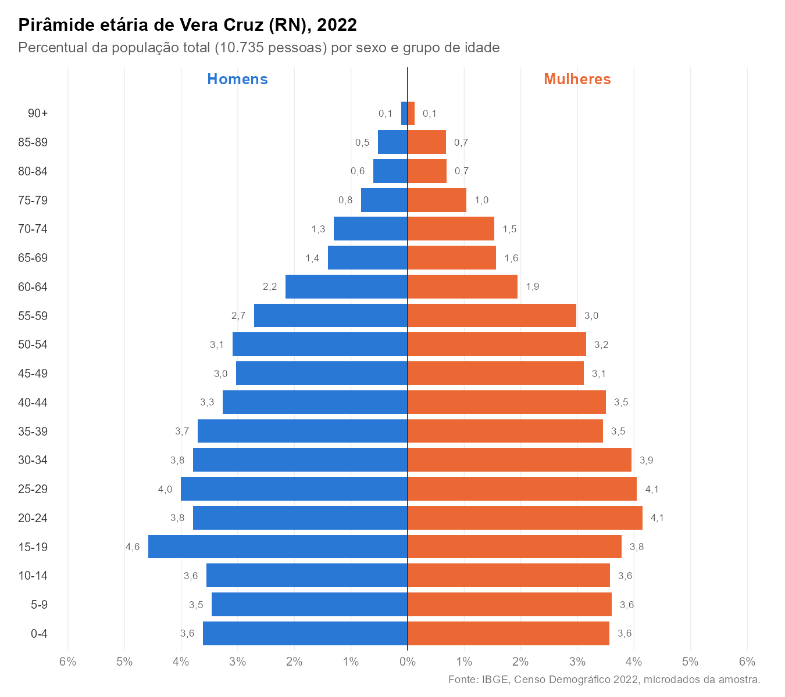

# Vera Cruz (RN)

Resultados do Censo Demográfico 2022 (microdados da amostra). Gerado por `R/05_readmes.R`; veja a [página dos municípios](../README.md) e o [README principal](../../../../README.md).

População: **10.735** pessoas (2.091 registros na amostra).

## Estrutura etária

| Indicador | Vera Cruz | RN |
|---|--:|--:|
| Razão de dependência jovem | 31,4 | 28,5 |
| Razão de dependência idosa | 15,2 | 15,1 |
| Razão de dependência total | 46,6 | 43,6 |
| Índice de envelhecimento | 48,6 | 52,9 |

Valores por 100 pessoas.

## Migração

Chegadas e saídas: mudanças de município nos últimos 10 anos.

| Indicador | Valor |
|---|--:|
| Nascidos no próprio município | 60,1% |
| Nascidos em outro município do Rio Grande do Norte | 34,5% |
| Nascidos em outra UF | 4,8% |
| Nascidos no exterior | 0,0% |
| Chegaram de outro município do Rio Grande do Norte | 1.348 |
| Chegaram de outra UF | 200 |
| Saíram para outro município da UF | 1.347 |
| Saíram para outra UF | 202 |
| Saldo migratório | 0 |
| Saldo por 1.000 habitantes | 0,0 |
| Chegaram do exterior | 7 |

Principais origens de quem chegou e destinos de quem saiu:

| Origem | Chegaram | Destino | Saíram |
|---|--:|---|--:|
| Natal (RN) | 465 | Natal (RN) | 374 |
| São José de Mipibu (RN) | 142 | São José de Mipibu (RN) | 266 |
| Macaíba (RN) | 132 | Monte Alegre (RN) | 191 |
| São Paulo (SP) | 130 | Montividiu (GO) | 105 |
| Parnamirim (RN) | 91 | Parnamirim (RN) | 103 |

## Mortalidade

Óbitos de agosto de 2021 a julho de 2022 informados no Censo.

| Indicador | Vera Cruz | RN |
|---|--:|--:|
| Óbitos no período | 73 | 22.488 |
| Registros de óbito na amostra | 14 |  |
| Taxa bruta de mortalidade (por mil) | 6,8 | 6,8 |
| Taxa padronizada por idade (por mil) | 6,9 | 6,8 |

Com poucos óbitos na amostra, as taxas deste município variam muito por acaso; por isso não há tábua de vida. Sem correção do sub-registro de óbitos do Censo.
