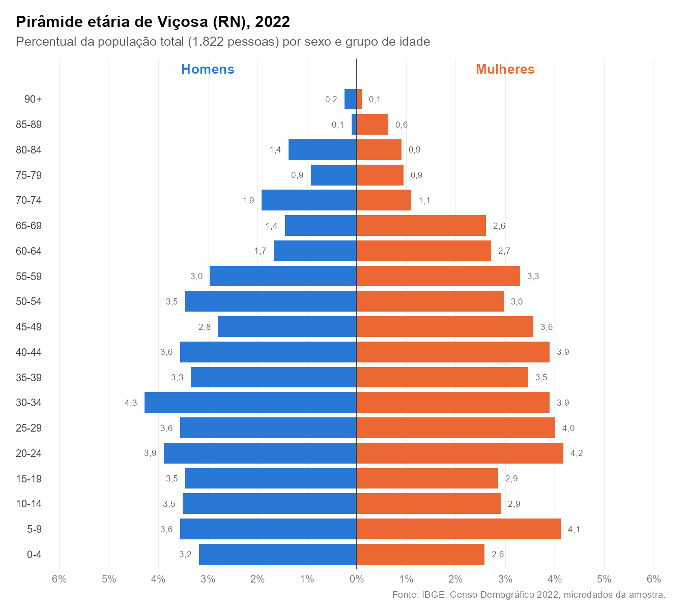

# Viçosa (RN)

Resultados do Censo Demográfico 2022 (microdados da amostra). Gerado por `R/05_readmes.R`; veja a [página dos municípios](../README.md) e o [README principal](../../../../README.md).

População: **1.822** pessoas (947 registros na amostra).

## Estrutura etária

| Indicador | Viçosa | RN |
|---|--:|--:|
| Razão de dependência jovem | 29,3 | 28,5 |
| Razão de dependência idosa | 18,1 | 15,1 |
| Razão de dependência total | 47,4 | 43,6 |
| Índice de envelhecimento | 61,9 | 52,9 |

Valores por 100 pessoas.

## Migração

Chegadas e saídas: mudanças de município nos últimos 10 anos.

| Indicador | Valor |
|---|--:|
| Nascidos no próprio município | 69,4% |
| Nascidos em outro município do Rio Grande do Norte | 25,3% |
| Nascidos em outra UF | 5,2% |
| Nascidos no exterior | 0,0% |
| Chegaram de outro município do Rio Grande do Norte | 250 |
| Chegaram de outra UF | 114 |
| Saíram para outro município da UF | 143 |
| Saíram para outra UF | 35 |
| Saldo migratório | +186 |
| Saldo por 1.000 habitantes | +102,0 |
| Chegaram do exterior | 3 |

Principais origens de quem chegou e destinos de quem saiu:

| Origem | Chegaram | Destino | Saíram |
|---|--:|---|--:|
| Portalegre (RN) | 63 | Natal (RN) | 33 |
| Mossoró (RN) | 62 | Portalegre (RN) | 20 |
| Louveira (SP) | 41 | Patu (RN) | 15 |
| Riacho da Cruz (RN) | 31 | Mossoró (RN) | 14 |
| Natal (RN) | 25 | Sumaré (SP) | 14 |

## Mortalidade

Óbitos de agosto de 2021 a julho de 2022 informados no Censo.

| Indicador | Viçosa | RN |
|---|--:|--:|
| Óbitos no período | 9 | 22.488 |
| Registros de óbito na amostra | 4 |  |
| Taxa bruta de mortalidade (por mil) | 5,1 | 6,8 |
| Taxa padronizada por idade (por mil) | 5,5 | 6,8 |

Com poucos óbitos na amostra, as taxas deste município variam muito por acaso; por isso não há tábua de vida. Sem correção do sub-registro de óbitos do Censo.
