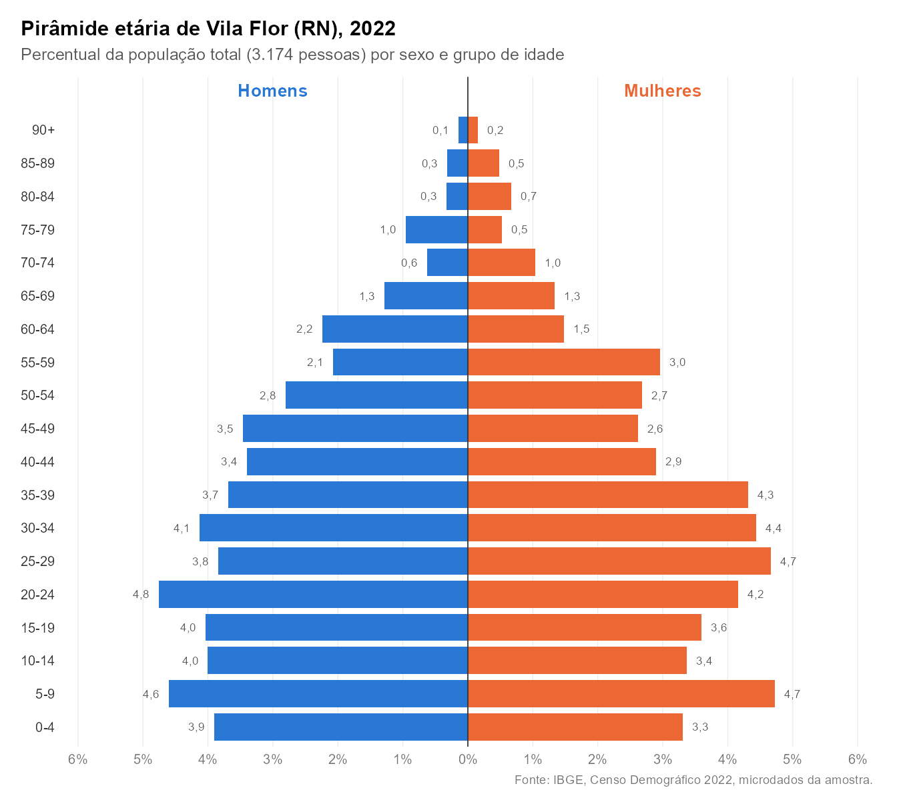

# Vila Flor (RN)

Resultados do Censo Demográfico 2022 (microdados da amostra). Gerado por `R/05_readmes.R`; veja a [página dos municípios](../README.md) e o [README principal](../../../../README.md).

População: **3.174** pessoas (1.061 registros na amostra).

## Estrutura etária

| Indicador | Vila Flor | RN |
|---|--:|--:|
| Razão de dependência jovem | 35,0 | 28,5 |
| Razão de dependência idosa | 11,5 | 15,1 |
| Razão de dependência total | 46,5 | 43,6 |
| Índice de envelhecimento | 32,8 | 52,9 |

Valores por 100 pessoas.

## Migração

Chegadas e saídas: mudanças de município nos últimos 10 anos.

| Indicador | Valor |
|---|--:|
| Nascidos no próprio município | 70,4% |
| Nascidos em outro município do Rio Grande do Norte | 21,8% |
| Nascidos em outra UF | 7,7% |
| Nascidos no exterior | 0,1% |
| Chegaram de outro município do Rio Grande do Norte | 338 |
| Chegaram de outra UF | 86 |
| Saíram para outro município da UF | 152 |
| Saíram para outra UF | 72 |
| Saldo migratório | +200 |
| Saldo por 1.000 habitantes | +62,9 |
| Chegaram do exterior | 0 |

Principais origens de quem chegou e destinos de quem saiu:

| Origem | Chegaram | Destino | Saíram |
|---|--:|---|--:|
| Canguaretama (RN) | 130 | Presidente Getúlio (SC) | 27 |
| Natal (RN) | 79 | Canguaretama (RN) | 24 |
| Goianinha (RN) | 31 | Goianinha (RN) | 23 |
| Pedro Velho (RN) | 17 | Dona Emma (SC) | 21 |
| Pendências (RN) | 11 | Parnamirim (RN) | 20 |

## Mortalidade

Óbitos de agosto de 2021 a julho de 2022 informados no Censo.

| Indicador | Vila Flor | RN |
|---|--:|--:|
| Óbitos no período | 15 | 22.488 |
| Registros de óbito na amostra | 5 |  |
| Taxa bruta de mortalidade (por mil) | 4,9 | 6,8 |
| Taxa padronizada por idade (por mil) | 5,4 | 6,8 |

Com poucos óbitos na amostra, as taxas deste município variam muito por acaso; por isso não há tábua de vida. Sem correção do sub-registro de óbitos do Censo.
